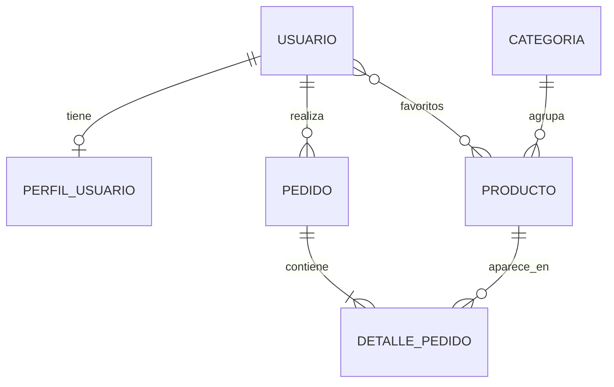

# 🛋️ Arte & Estilo — Backend

Backend REST para la plataforma e-commerce de muebles y decoración **Arte & Estilo**, desarrollado como proyecto académico para el **CESDE**.

Construido con **Java 17 + Spring Boot 4 + Spring Data JPA + PostgreSQL (Neon)**, con arquitectura por capas (controller → service → repository → model), **DTOs** como contrato de la API y documentación **OpenAPI / Swagger UI**.

---

## 📋 Tabla de contenidos

- [Características](#-características)
- [Stack tecnológico](#-stack-tecnológico)
- [Arquitectura del proyecto](#-arquitectura-del-proyecto)
- [DTOs](#-dtos)
- [Modelo de datos](#-modelo-de-datos)
- [Reglas de negocio](#-reglas-de-negocio)
- [Requisitos previos](#-requisitos-previos)
- [Configuración y ejecución](#-configuración-y-ejecución)
- [Documentación OpenAPI](#-documentación-openapi)
- [Endpoints](#-endpoints)
- [Manejo de errores](#-manejo-de-errores)
- [Datos iniciales](#-datos-iniciales)
- [Flujo de trabajo Git](#-flujo-de-trabajo-git)
- [Autor](#-autor)

---

## ✨ Características

- API REST versionada (`/api/v1/...`) con CRUD completo: `GET`, `POST`, `PUT`, `PATCH` y `DELETE`.
- **DTOs** (`record` de Java) de entrada y salida: las entidades nunca se exponen.
- Validación de datos de entrada con **Bean Validation** (`@Valid`).
- Documentación interactiva con **OpenAPI 3 / Swagger UI**.
- Persistencia con **JPA / Hibernate** sobre **PostgreSQL**.
- Entidades con herencia vía `@MappedSuperclass` para campos auditables.
- Componente embebido (`@Embeddable`) para direcciones de envío.
- Enumeraciones persistidas como `STRING` (`EstadoPedido`).
- Manejo centralizado de excepciones con `@RestControllerAdvice`.
- Eliminación **lógica** (`estadoActivo = false`) para conservar el historial de pedidos.
- Validación y descuento de stock transaccional.
- Descuento automático del 10 % en compras superiores a **$2.000.000 COP**.
- Cancelación controlada de pedidos con reintegro de inventario.
- Endpoints personalizados: cancelar pedido, productos con bajo stock y búsqueda de usuario por correo.
- Datos iniciales idempotentes (`DataSeederConfig`).

---

## 🧰 Stack tecnológico

| Componente                  | Versión / detalle          |
|-----------------------------|----------------------------|
| Java                        | 17                         |
| Spring Boot                 | 4.1.1                      |
| Spring Web MVC              | incluido en Boot           |
| Spring Data JPA (Hibernate) | incluido en Boot           |
| Bean Validation             | `spring-boot-starter-validation` |
| springdoc-openapi           | 3.1.1 (Swagger UI)         |
| PostgreSQL Driver           | runtime                    |
| Lombok                      | en entidades               |
| Spring Boot DevTools        | runtime                    |
| Maven                       | wrapper `./mvnw`           |
| Base de datos               | PostgreSQL en Neon (cloud) |

---

## 🏗️ Arquitectura del proyecto

```
com.cesde.arteestilo
 ├── ArteEstiloApplication.java
 ├── config/         → OpenApiConfig, DataSeederConfig
 ├── controller/     → Endpoints REST (@RestController) con anotaciones OpenAPI
 ├── dto/            → Records de entrada (Request / Patch) y salida (Response)
 ├── service/        → Reglas de negocio (@Service, @Transactional) y conversión entidad ↔ DTO
 ├── repository/     → Acceso a datos (JpaRepository)
 ├── model/          → Entidades JPA, enums y embebidos
 └── exception/      → Excepciones personalizadas + GlobalExceptionHandler
```

---

## 📦 DTOs

Un **DTO** (*Data Transfer Object*) define qué datos entran y salen por la API, separado de la entidad que se guarda en la base de datos. Evita exponer campos internos, impide el JSON recursivo entre entidades relacionadas y permite validar la entrada.

```
Cliente --JSON--> Request DTO --> Service --> Entidad --> BD
Cliente <--JSON-- Response DTO <-- Service <-- Entidad <-- BD
```

| Tipo       | Se usa en        | Característica                                          |
|------------|------------------|---------------------------------------------------------|
| `*Request` | `POST` y `PUT`   | Todos los campos obligatorios, con validaciones         |
| `*Patch`   | `PATCH`          | Campos opcionales: solo se modifica lo que se envía     |
| `*Response`| todos los `GET`  | Solo lo que se muestra; ids en lugar de objetos anidados|

Dependiendo de la entidad existen: `Categoria*`, `Producto*`, `Usuario*`, `Pedido*` (`PedidoRequest`, `PedidoEstadoPatch`, `PedidoResponse`), `DetallePedido*` y `DireccionEnvioDTO`.

---

## 🗃️ Modelo de datos

Entidades principales (todas heredan de `BaseEntity`):

| Entidad          | Descripción                                                                                          | Relaciones clave                                                                          |
|------------------|------------------------------------------------------------------------------------------------------|-------------------------------------------------------------------------------------------|
| `BaseEntity`     | Clase abstracta `@MappedSuperclass` con `id`, `fechaCreacion`, `fechaActualizacion`, `estadoActivo`. | —                                                                                         |
| `Usuario`        | Cliente de la tienda.                                                                                | `@OneToOne` con `PerfilUsuario`, `@ManyToMany` con `Producto` (favoritos).                |
| `PerfilUsuario`  | Información extendida del usuario.                                                                   | `@OneToOne(mappedBy="perfilUsuario")`.                                                    |
| `Categoria`      | Categoría de productos (Sillas, Mesas, etc.).                                                        | `@OneToMany` con `Producto`.                                                              |
| `Producto`       | Artículo de decoración o mueble.                                                                     | `@ManyToOne` con `Categoria`, `@ManyToMany(mappedBy="favoritos")`.                        |
| `Pedido`         | Orden de compra.                                                                                     | `@ManyToOne` con `Usuario`, `@OneToMany` con `DetallePedido`, `@Embedded DireccionEnvio`. |
| `DetallePedido`  | Línea de un pedido.                                                                                  | `@ManyToOne` con `Pedido` y `Producto`.                                                   |
| `DireccionEnvio` | `@Embeddable` con dirección, ciudad, departamento, referencia.                                       | —                                                                                         |
| `EstadoPedido`   | Enum: `PENDIENTE`, `EN_CAMINO`, `ENTREGADO`, `CANCELADO`.                                            | —                                                                                         |



---

## 📐 Reglas de negocio

### Regla 1 — Validación y deducción de stock al crear pedido

Al registrar un pedido se verifica que el stock de cada producto sea **≥** a la cantidad solicitada.

- ❌ Si no hay stock → `StockInsuficienteException` → **HTTP 400**.
- ✅ Si hay stock → descuenta inventario, calcula el total y persiste el pedido con sus detalles.

### Regla 2 — Descuento por compra superior

Si el total del pedido **supera $2.000.000 COP**, se aplica automáticamente un **10 % de descuento**.

- ❌ Si el monto es nulo o negativo → `MontoInvalidoException` → **HTTP 400**.
- ✅ Si no supera el monto → se procesa sin descuento.

### Regla 3 — Cancelación controlada de pedidos

Un pedido solo se puede cancelar si está en estado `PENDIENTE`.

- ❌ Si está `EN_CAMINO`, `ENTREGADO` o ya `CANCELADO` → `PedidoNoCancelableException` → **HTTP 400**.
- ✅ Si está `PENDIENTE` → cambia a `CANCELADO` y **reintegra el stock** de todos sus productos.

### Reglas adicionales

- El estado de un pedido avanza solo así: `PENDIENTE → EN_CAMINO → ENTREGADO`. Cualquier otra transición devuelve **400**.
- Los correos de usuario y los nombres de categoría son únicos: duplicarlos devuelve **409**.
- No se puede eliminar una categoría con productos activos (**409**).
- `DELETE` es una baja lógica: el registro se marca como inactivo y deja de aparecer en los listados.

---

## ✅ Requisitos previos

- **JDK 17** o superior.
- **Maven** (o usar el wrapper `./mvnw`).
- Cuenta en **Neon** (o cualquier PostgreSQL accesible vía JDBC con `sslmode=require`).
- **Git** configurado.
- Variables de entorno configuradas (ver siguiente sección).

---

## ⚙️ Configuración y ejecución

### 1. Clonar el repositorio

```bash
git clone https://github.com/SESsantiago/arte-estilo-backend.git
cd arte-estilo-backend
```

### 2. Crear el archivo `.env`

Copia la plantilla `.env.example` y completa los valores reales:

```bash
cp .env.example .env
```

Contenido esperado:

```
DB_URL=jdbc:postgresql://<HOST_NEON>:<PORT>/<DB_NAME>?sslmode=require
DB_USERNAME=<USUARIO>
DB_PASSWORD=<PASSWORD>
```

> `application.properties` lee estas variables con `${DB_URL}`, `${DB_USERNAME}` y `${DB_PASSWORD}`.
> El archivo `.env` está en `.gitignore`: **nunca debe subirse al repositorio**.

### 3. Ejecutar la aplicación

**Linux / macOS:**

```bash
set -a && source .env && set +a && ./mvnw spring-boot:run
```

Para usar otro puerto (por defecto es el 8080):

```bash
set -a && source .env && set +a && PORT=8081 ./mvnw spring-boot:run
```

**PowerShell:**

```powershell
Get-Content .env | ForEach-Object {
    if ($_ -match '^\s*([^#][^=]+)=(.*)$') {
        [Environment]::SetEnvironmentVariable($matches[1], $matches[2], 'Process')
    }
}
.\mvnw.cmd spring-boot:run
```

**IntelliJ IDEA / VS Code:** configurar las variables en la *Run Configuration* o instalar el plugin de `.env`.

La API queda disponible en:

```
http://localhost:8080/api/v1
```

> `spring.jpa.hibernate.ddl-auto=update` crea/actualiza automáticamente el esquema en el primer arranque.

---

## 📖 Documentación OpenAPI

Con la aplicación en marcha:

| URL                                      | Qué es                                          |
|------------------------------------------|-------------------------------------------------|
| `http://localhost:8080/swagger-ui.html`  | Interfaz interactiva para probar los endpoints  |
| `http://localhost:8080/v3/api-docs`      | Especificación OpenAPI en JSON                  |

Desde Swagger UI se puede abrir cualquier endpoint, pulsar **Try it out**, completar el JSON y ejecutarlo.

---

## 🌐 Endpoints

Todos bajo el prefijo `/api/v1`. Los marcados con ⭐ son endpoints personalizados.

### Categorías

| Método   | Endpoint           | Descripción                                    | Códigos               |
|----------|--------------------|------------------------------------------------|-----------------------|
| `GET`    | `/categorias`      | Lista las categorías activas.                  | 200                   |
| `GET`    | `/categorias/{id}` | Obtiene una categoría.                         | 200 / 404             |
| `POST`   | `/categorias`      | Crea una categoría.                            | 201 / 400 / 409       |
| `PUT`    | `/categorias/{id}` | Reemplaza una categoría completa.              | 200 / 400 / 404 / 409 |
| `PATCH`  | `/categorias/{id}` | Actualiza campos de una categoría.             | 200 / 400 / 404 / 409 |
| `DELETE` | `/categorias/{id}` | Baja lógica (sin productos activos).           | 204 / 404 / 409       |

### Productos

| Método   | Endpoint                          | Descripción                                                    | Códigos         |
|----------|-----------------------------------|----------------------------------------------------------------|-----------------|
| `GET`    | `/productos?categoria=&minStock=` | Lista productos activos, con filtros opcionales.               | 200             |
| `GET`    | `/productos/bajo-stock?limite=5` ⭐ | Productos con stock menor o igual al límite, del más escaso al menos escaso. | 200 / 400 |
| `GET`    | `/productos/{id}`                 | Obtiene un producto.                                           | 200 / 404       |
| `POST`   | `/productos`                      | Crea un producto.                                              | 201 / 400 / 404 |
| `PUT`    | `/productos/{id}`                 | Reemplaza un producto completo.                                | 200 / 400 / 404 |
| `PATCH`  | `/productos/{id}`                 | Actualiza campos de un producto.                               | 200 / 400 / 404 |
| `DELETE` | `/productos/{id}`                 | Baja lógica.                                                   | 204 / 404       |

### Usuarios

| Método   | Endpoint                         | Descripción                                   | Códigos               |
|----------|----------------------------------|-----------------------------------------------|-----------------------|
| `GET`    | `/usuarios`                      | Lista los usuarios activos.                   | 200                   |
| `GET`    | `/usuarios/buscar?correo=` ⭐    | Busca un usuario por correo exacto.           | 200 / 404             |
| `GET`    | `/usuarios/{id}`                 | Obtiene un usuario.                           | 200 / 404             |
| `POST`   | `/usuarios`                      | Crea un usuario (perfil opcional).            | 201 / 400 / 409       |
| `PUT`    | `/usuarios/{id}`                 | Reemplaza un usuario completo.                | 200 / 400 / 404 / 409 |
| `PATCH`  | `/usuarios/{id}`                 | Actualiza campos de un usuario.               | 200 / 400 / 404 / 409 |
| `DELETE` | `/usuarios/{id}`                 | Baja lógica.                                  | 204 / 404             |

### Pedidos

| Método  | Endpoint                          | Descripción                                                              | Códigos         |
|---------|-----------------------------------|--------------------------------------------------------------------------|-----------------|
| `GET`   | `/pedidos?usuarioId=&estado=`     | Lista pedidos. Filtra solo si se envían ambos parámetros.                | 200 / 400       |
| `GET`   | `/pedidos/{id}`                   | Obtiene un pedido.                                                       | 200 / 404       |
| `POST`  | `/pedidos`                        | Crea un pedido (aplica Reglas 1 y 2).                                    | 201 / 400 / 404 |
| `POST`  | `/pedidos/{id}/cancelar` ⭐       | Cancela un pedido (aplica Regla 3).                                      | 200 / 400 / 404 |
| `PATCH` | `/pedidos/{id}/estado`            | Avanza el estado: `PENDIENTE → EN_CAMINO → ENTREGADO`.                   | 200 / 400 / 404 |

Los pedidos no se eliminan: son registros históricos y se anulan con `/cancelar`.

### Ejemplo de request — crear pedido

```bash
curl -X POST http://localhost:8080/api/v1/pedidos \
  -H "Content-Type: application/json" \
  -d '{
    "usuarioId": 1,
    "direccionEnvio": {
      "direccion": "Cra 45 #12-34",
      "ciudad": "Medellín",
      "departamento": "Antioquia",
      "referencia": "Apto 502"
    },
    "detalles": [
      { "productoId": 1, "cantidad": 2 },
      { "productoId": 3, "cantidad": 1 }
    ]
  }'
```

Respuesta (`201 Created`, ids de ejemplo):

```json
{
  "id": 1,
  "usuarioId": 1,
  "usuarioNombre": "Santiago Espinosa",
  "estado": "PENDIENTE",
  "totalCompra": 2250000.00,
  "direccionEnvio": {
    "direccion": "Cra 45 #12-34",
    "ciudad": "Medellín",
    "departamento": "Antioquia",
    "referencia": "Apto 502"
  },
  "detalles": [
    {
      "productoId": 3,
      "productoNombre": "Sofá de Lujo Italiano",
      "cantidad": 1,
      "precioUnitario": 2500000.00,
      "subtotal": 2500000.00
    }
  ],
  "fechaCreacion": "2026-10-28T14:32:11.482"
}
```

---

## 🚨 Manejo de errores

Todas las excepciones se traducen a un DTO estándar mediante `GlobalExceptionHandler`:

```json
{
  "fecha": "2026-10-28T14:32:11.482",
  "mensaje": "Stock insuficiente para el producto 'Silla Nórdica de Roble'. Disponible: 3, solicitado: 5",
  "codigoHttp": 400
}
```

| Excepción / situación                        | HTTP             |
|----------------------------------------------|------------------|
| `StockInsuficienteException`                 | 400 Bad Request  |
| `MontoInvalidoException`                     | 400 Bad Request  |
| `PedidoNoCancelableException`                | 400 Bad Request  |
| `IllegalArgumentException`                   | 400 Bad Request  |
| Datos inválidos en el cuerpo (`@Valid`)      | 400 Bad Request  |
| JSON mal formado o parámetro con tipo inválido | 400 Bad Request |
| `RecursoNoEncontradoException`               | 404 Not Found    |
| `ConflictoException` (duplicados, dependencias) | 409 Conflict  |
| Violación de restricción en la base de datos | 409 Conflict     |

---

## 🌱 Datos iniciales

`DataSeederConfig` carga datos de ejemplo al arrancar (un usuario, las categorías *Sillas*, *Mesas* y *Sofás*, y tres productos). Es **idempotente**: busca cada elemento antes de crearlo, así que puede ejecutarse en cada arranque sin duplicar ni fallar.

---

## 🌿 Flujo de trabajo Git

Este proyecto utiliza **Git Flow** con **Conventional Commits**.

- Rama de producción: **`main`**
- Rama de integración: **`develop`**
- Ramas de trabajo: `feature/XX-nombre`, `fix/nombre`, `docs/nombre`, `copia/nombre`

### Convención de commits

```
feat:     nueva funcionalidad
fix:      corrección de bug
chore:    tareas de mantenimiento / configuración
docs:     documentación
refactor: reestructuración sin cambio funcional
```

### Ramas utilizadas

| Rama                                  | Propósito                                                      |
|---------------------------------------|----------------------------------------------------------------|
| `feature/01-modelos-jpa`              | Entidades JPA, enums, embeddables y `BaseEntity`.              |
| `feature/02-capa-repositorios`        | Repositorios JpaRepository + queries personalizadas.           |
| `feature/03-capa-servicios`           | Excepciones, servicios y reglas de negocio.                    |
| `feature/04-capa-controladores`       | Controladores REST y `ResponseEntity`.                         |
| `bugfix/01-arquitectura`              | Corrección de capas y nomenclatura.                            |
| `copia/terminacion-avance-momento2`   | DTOs, CRUD completo, endpoints personalizados y OpenAPI.       |
| `feature/metodo-personalizado-usuario`| Búsqueda de usuario por correo.                                |
| `feature/config-DataSeederConfig`     | Datos iniciales al arrancar.                                   |
| `fix/seeder-idempotente`              | Seeder idempotente y categoría *Sofás*.                        |
| `docs/readme-momento2`                | Actualización de este README.                                  |

### Versionado

Primera entrega etiquetada como **`v1.0.0`** en `main`.

---

## 👨‍💻 Autor

**Proyecto académico — CESDE**
Repositorio: [arte-estilo-backend](https://github.com/SESsantiago/arte-estilo-backend)
Año: 2026

---

## 📄 Licencia

Proyecto con fines educativos. Uso libre para propósitos académicos.
